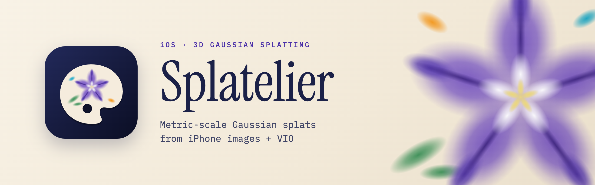

<p align="center">
  
</p>

<p align="center">
  <a href="LICENSE"></a>
  <a href="https://github.com/shuta-ochiai/Splatelier/tags"></a>
  
  
</p>

**Capture, train and view 3D Gaussian Splats entirely on your iPhone.**

Splatelier (from *splat* + *atelier*) turns a short walk around an object or a room into a 3D
Gaussian Splatting scene. Capture, camera pose refinement, training and viewing all run on the
device: no server, no upload, no desktop GPU.

Under the hood, the trainer is written in Swift on [MLX-Swift](https://github.com/ml-explore/mlx-swift),
and the differentiable rendering kernels are written in [Slang](https://github.com/shader-slang/slang)
and compiled to Metal.

> **Status:** early release. The app is built from source with Xcode and is not on the App Store.
> Expect rough edges, and expect settings and file formats to change.

## Features

- **Guided capture**: ARKit images and poses, a live splat preview that shows which parts of the
  scene are covered, and frames that would come out motion-blurred left out of training.
- **On-device training**: bundle adjustment refines the ARKit poses, multi-view stereo provides dense
  seed points, and the Gaussians are trained on the iPhone's GPU, with each frame's exposure and
  white balance compensated. Training adapts to the device's temperature, and a finished model can
  be trained further.
- **Built-in viewer**: orbit the result, choose the layers to show, measure distances, grade the
  colours, crop the splats with a box, sphere or lasso, and select and delete floaters. The Library
  lists your captures and opens `.ply`, `.splat` and `.spz` files you import.
- **Export**: share the splats as a standard 3DGS PLY, compressed PLY, SPZ, `.splat`, glTF (GLB), SOG
  or OpenUSD (`.usda`), and the mesh (OBJ) generated from the trained scene.
- **Mac tools**: retrain a capture from the app on a Mac, train and evaluate on COLMAP scenes, and
  convert PLY files from the command line.

## Requirements

- An iPhone or iPad with iOS 18 or later. ARKit capture and training need a real device. LiDAR
  is not required; on devices that have it, an experimental switch on the Capture screen records
  LiDAR depth as well and uses it for the seed points (off by default).
- An Apple Silicon Mac with macOS 15 or later and Xcode 16 (iOS 18 SDK) to build the app.
- An Apple account added to Xcode as a development team, to sign the app.

## Install the app

1. Clone the repository and open the Xcode project:

   ```sh
   git clone https://github.com/shuta-ochiai/Splatelier.git
   cd Splatelier
   open App/Splatelier.xcodeproj
   ```

2. In the **Splatelier** target's *Signing & Capabilities*, choose your team and change the bundle
   identifier to one your account can use. To keep these settings when the project is regenerated,
   set `DEVELOPMENT_TEAM` and `PRODUCT_BUNDLE_IDENTIFIER` in `App/project.yml` as well (see
   [Editing the Xcode project](#editing-the-xcode-project)).
3. Turn on Developer Mode on the device (*Settings → Privacy & Security → Developer Mode*).
4. Select the **Splatelier** scheme and your device, and run. The scheme builds in Release, because
   training in Debug is much slower.

## Using the app

1. In the **Capture** tab, tap **Start capture** and walk slowly around the subject. Keep it in view
   and cover it from several heights.
2. Tap **Stop**. The same screen now shows the capture; choose the number of iterations and the
   Gaussian cap, and tap **Start training**. Progress appears in place.
3. When training finishes, a mesh is generated automatically and the result opens in the viewer.
   From there you can **Share** the files, **Train more**, or tap **Hint** for the controls. Trained
   models are listed in the **Library** tab and in the Files app.

Tips: even lighting and a textured subject give the best results. Shiny, transparent and plain
white surfaces are hard to reconstruct.

## Mac command-line tool

The Swift package also builds a command-line tool, `splatelier`.

```sh
make build                                                   # swift build
make test                                                    # package tests via xcodebuild
scripts/run-release.sh train-capture <dataset.valset> out.ply
```

Main commands (run `splatelier` without arguments for the full usage):

```text
train <colmap_scene_dir> <output.ply> [iterations] ...    train on a COLMAP scene
eval | compare | render                                   evaluate on a COLMAP scene
train-capture <dataset.valset> <output.ply> [iterations]  retrain an app capture with the app's
                                                          settings (MESH_OBJ=<path> also writes a mesh)
view | capture | stats | cull                             viewer and PLY tools
convert <in.ply> <out.ext> [shDegree]                     convert a PLY to compressed PLY, SPZ, .splat,
                                                          GLB, SOG or OpenUSD (.usda)
```

- A capture can be saved from the app as a `.valset` dataset and shared to the Mac.
- `EVAL_HOLDOUT=N` with `train-capture` holds out every Nth frame and logs PSNR.
- Train and measure with release builds. `scripts/run-release.sh` builds release, adds MLX's
  metallib and runs the tool.
- GPU tests and training need Xcode's toolchain (`xcodebuild`), not plain `swift test`, because of
  MLX's Metal shaders.
- The viewer commands (`view`, `capture`) need `scripts/build-metalsplatter-metallib.sh [debug|release]`
  first.
- The COLMAP integration tests take a local scene:
  `TEST_RUNNER_MST_COLMAP_DIR=$PWD/data/bear make test`.

## Development

### Editing the Xcode project

The Xcode project is generated from `App/project.yml` with [XcodeGen](https://github.com/yonaskolb/XcodeGen)
and checked in. Make project changes in `project.yml` and run `cd App && xcodegen generate`. Anything
set only in the `.xcodeproj` is lost on regeneration.

### Slang kernels

```sh
./scripts/install_slang.sh
./scripts/compile_slang.sh          # regenerate
./scripts/compile_slang.sh --check  # check that the checked-in output is current
```

The generated `.metal` and `.refl.json` files are checked in under `Sources/Trainer/Resources/Slang`,
so Slang is only needed to edit `.slang` kernels. Generation is deterministic, so comment-only edits
leave them unchanged.

### Animations

The launch animation and the capture-guide clips are rendered by `scripts/media/`
(`scripts/media/build_media.sh`; see its [README](scripts/media/README.md)). The videos are checked
in, so this is only needed to change them.

### Continuous integration

CI builds the package and the iOS app, and checks that the generated Metal kernels match their Slang
sources. It does not run the tests, because most of them need a Metal GPU: run `make test` locally.

### How it works

- **Frame selection**: frames whose recorded camera motion would blur them by more than 3 px over the
  exposure are left out (for datasets without the motion, an image-based blur test); badly exposed
  frames are left out too.
- **Poses and seed points**: bundle adjustment over ORB and ARKit feature tracks, with loop closures
  between frames that see the same ARKit feature points (the points are eliminated by per-point QR
  and the reduced system is solved with Accelerate); the cameras are held to ARKit's frame-to-frame
  motion more than to its absolute poses, which its own loop closure can bend; and dense seed
  points from multi-view stereo (plane sweep + SGM). With the experimental LiDAR switch, LiDAR depth,
  reprojected with the refined poses, joins the seed points.
- **Training**: PocketGS disc-like initialization; a hybrid of MCMC and ImprovedGS+
  long-axis split for densification, whose prune takes faint Gaussians larger than the median; a
  directional spherical-harmonics background; per-frame exposure and white balance gains; fused
  SSIM; coarse-to-fine; thermal throttling; continued training with the Adam state kept.
- **Output**: a standard 3DGS PLY (SH degree 1, written in the degree-3 layout so common viewers read
  it) with the background baked into a far shell of Gaussians, and a TSDF mesh that is generated
  automatically after training.
- **Viewer**: [MetalSplatter](https://github.com/scier/MetalSplatter) with local patches: blending that
  matches training, stochastic transparency while the camera moves, a mesh overlay, hiding the
  background and distance measurement. See [VENDORED.md](Vendor/MetalSplatter/VENDORED.md).

### Repository layout

```text
App/                       iOS app; project.yml is the source of truth
Sources/Trainer/           renderer, trainer, densification, BA and MVS, PLY I/O
Sources/Capture/           ARKit capture, training from captures, .valset storage
Sources/SplatViewerKit/    SwiftUI + MetalKit viewer
Sources/CLI/               command-line tool
scripts/                   build, release and animation scripts (scripts/media/ renders the animations)
slang/                     Slang kernel sources
Vendor/MetalSplatter/      vendored MetalSplatter with local patches
Tests/                     unit and GPU tests
```

## Acknowledgments

Splatelier is built on [mlx-swift](https://github.com/ml-explore/mlx-swift) (MIT) and
[Slang](https://github.com/shader-slang/slang), and its viewer is a modified copy of
[MetalSplatter](https://github.com/scier/MetalSplatter) (MIT, see
[VENDORED.md](Vendor/MetalSplatter/VENDORED.md)).

We referred to the code of these projects while writing our own:

- [gsplat](https://github.com/nerfstudio-project/gsplat) (Apache-2.0): the numerical reference for
  the rasterizer, projection, spherical harmonics, Adam, MCMC densification and the PLY layout
- [splatfacto-w](https://github.com/KevinXu02/splatfacto-w) (Apache-2.0): the directional SH
  background and the alpha-loss mask
- [VkSplat](https://github.com/harry7557558/vksplat) (Apache-2.0): the 32-bit tile and depth sort key
- [libSGM](https://github.com/fixstars/libSGM) (Apache-2.0): splitting SGM aggregation across a SIMD
  group, and the ratio of the default penalties
- [COLMAP](https://github.com/colmap/colmap) (BSD-3-Clause): the radial distortion model, and the
  binary reconstruction format
- [SuperSplat](https://github.com/playcanvas/supersplat) and the
  [PlayCanvas Engine](https://github.com/playcanvas/engine) (MIT): stochastic transparency in the
  viewer
- [splat-transform](https://github.com/playcanvas/splat-transform) (MIT): the compressed PLY, SOG
  and glTF (KHR_gaussian_splatting) export layouts, and the codebook quantization and Morton order
  used by them

The animations in the app (`scripts/media/`) are drawn with these fonts, all under the SIL Open Font
License 1.1: [Instrument Serif](https://github.com/Instrument/instrument-serif),
[Lora](https://github.com/cyrealtype/Lora-Cyrillic) and
[Noto Sans JP](https://github.com/notofonts/noto-cjk).

Main papers:

- [3D Gaussian Splatting for Real-Time Radiance Field Rendering](https://arxiv.org/abs/2308.04079)
- [PocketGS: On-Device Training of 3D Gaussian Splatting for High Perceptual Modeling](https://arxiv.org/abs/2601.17354):
  disc-like initialization, replay cache, geometry prior
- [3D Gaussian Splatting as Markov Chain Monte Carlo](https://arxiv.org/abs/2404.09591): densification
- [ImprovedGS+](https://arxiv.org/abs/2603.08661): long-axis split
- [Splatfacto-W](https://arxiv.org/abs/2407.12306): directional SH background
- [PPISP: Physically-Plausible Compensation and Control of Photometric Variations in Radiance Field Reconstruction](https://arxiv.org/abs/2601.18336)
  ([code](https://github.com/nv-tlabs/ppisp), Apache-2.0): per-frame exposure and white balance gain
- [Semi-Global Matching](https://doi.org/10.1109/TPAMI.2007.1166) and Mobile3DRecon (ISMAR 2020):
  multi-view stereo
- [Bundle Adjustment — A Modern Synthesis](https://doi.org/10.1007/3-540-44480-7_21)

<details>
<summary>All papers whose methods Splatelier implements</summary>

| Method | Paper |
|---|---|
| 3D Gaussian Splatting | Kerbl et al. 2023, ACM TOG 42(4) |
| 3D Gaussian Splatting as MCMC | Kheradmand et al. 2024 |
| EWA splatting (viewer's 2D covariance) | Zwicker et al. 2001, IEEE Visualization |
| SteadySplats (viewer's temporal accumulation while moving) | Windisch et al. 2026, arXiv 2610.05576 |
| PocketGS | arXiv 2601.17354 |
| ImprovedGS+ | arXiv 2603.08661 |
| Mobile3DRecon | Yang et al. 2020, ISMAR |
| Splatfacto-W | Xu et al. 2024 |
| PPISP (exposure and colour part) | arXiv 2601.18336 |
| Space-sweep multi-view matching | Collins 1996 |
| Semi-Global Matching | Hirschmüller 2005, 2008 |
| Census transform | Zabih & Woodfill 1994; Fife & Archibald 2013 |
| Stereo confidence measures | Hu & Mordohai 2012 |
| Bundle adjustment | Triggs et al. 2000; Solà et al. 2018 |
| Square-root bundle adjustment (point elimination by QR) | Demmel et al. 2021, CVPR |
| Shifted CholeskyQR | Fukaya et al. 2020, SIAM J. Sci. Comput. |
| FAST, BRIEF, ORB | Rosten & Drummond 2006; Calonder et al. 2010; Rublee et al. 2011 |
| Ratio test | Lowe 2004 |
| Similarity transform alignment | Umeyama 1991 |
| TSDF fusion | Curless & Levoy 1996 |
| Surfel fusion | Keller et al. 2013, 3DV |
| Marching Cubes | Lorensen & Cline 1987 |
| Gaussian Opacity Fields | Yu et al. 2024, ACM TOG 43(6) |
| Sorted Opacity Fields | Radl et al. 2025, SIGGRAPH Asia |
| Geometry-Grounded Gaussian Splatting | Zhang et al. 2026, arXiv 2601.17835 |
| SSIM | Wang et al. 2004 |
| Spherical harmonics constants | Sloan 2008 |
| Closed-form 3×3 eigenvalues | Smith 1961 |
| Blur metric (edge width) | Marziliano et al. 2002 |

</details>

## License

Apache License 2.0. See [LICENSE](LICENSE). Third-party components keep their own licenses.
